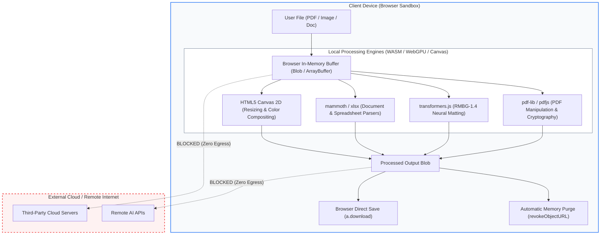
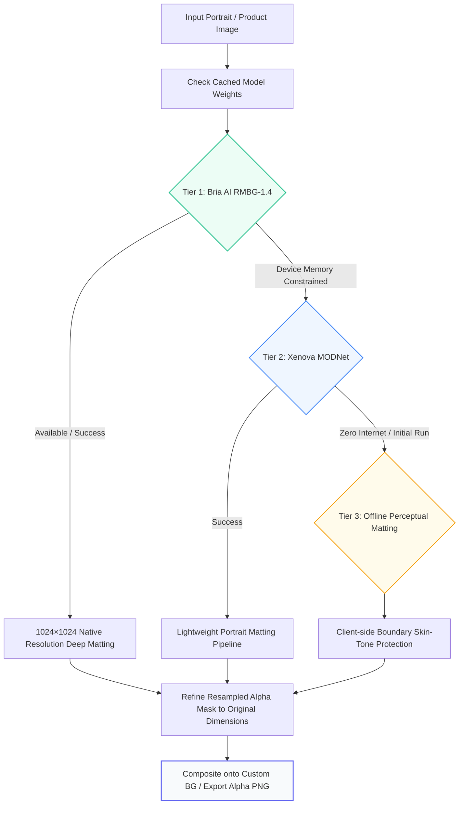
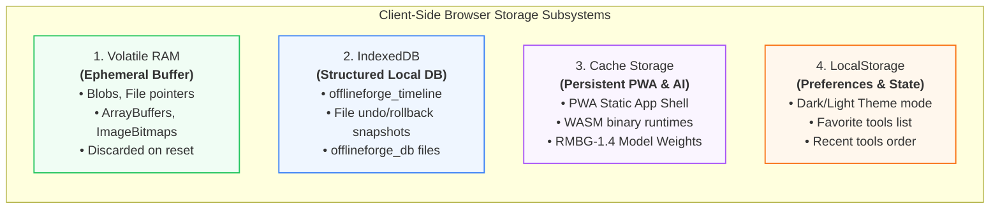

# Offline Toolkit 🛠️

> **100% Client-Side, In-Browser File & Document Engineering Suite.**  
> Zero server uploads. Complete data privacy. Runs entirely on your device via WebAssembly, WebGPU, and modern browser APIs.

[](https://opensource.org/licenses/MIT)
[](https://vitejs.dev/)
[](https://react.dev/)
[](https://www.typescriptlang.org/)
[](https://web.dev/progressive-web-apps/)

---

## 🌟 Overview

**Offline Toolkit** is a privacy-first web application featuring over **45+ high-performance utility tools** for PDF manipulation, image editing, AI neural background removal, biometric passport photos, document conversion, audio/video processing, and developer utilities.

Unlike conventional online tools that upload your sensitive documents, PDFs, and private photos to third-party cloud servers, **Offline Toolkit processes 100% of your data locally within your browser's runtime environment**.

---

## 🏗️ Architecture & Data Flowcharts

### 1. Zero-Egress Processing Lifecycle

Every file operation executes entirely inside the browser's local sandbox. No data packets ever leave your machine:



---

### 2. AI Background Matting & Multi-Tier Fallback Pipeline

For background removal in both the **AI Background Remover** and **Passport Photo Maker**, the tool uses a robust 3-tier cascade that guarantees inference succeeds even under severe resource or connectivity limits:



---

## 💾 Data Storage Architecture

Offline Toolkit does **not** employ any remote database. All storage is partitioned into four distinct client-side browser layers:



### Detailed Storage Tier Breakdown

| Storage Tier | Technology | Purpose & Contents | Persistence |
| :--- | :--- | :--- | :--- |
| **Volatile RAM** | JS Heap, `Blob`, `ArrayBuffer` | Raw uploaded documents, decoded image pixels, and active canvas operations. | **Ephemeral:** Automatically freed when a tool is closed, reset, or when `URL.revokeObjectURL()` executes. |
| **IndexedDB** | `indexedDB` API (`offlineforge_timeline`, `offlineforge_db`) | **Version Timeline:** Step-by-step document snapshots that allow instant multi-level undo/rollback.<br>**File Staging:** Temporary document state between tool chaining. | **Persistent:** Stored only on your device disk until cleared by user or browser quota. |
| **Cache Storage** | Service Worker `caches` API | **PWA Assets:** Precached JavaScript bundles, CSS stylesheets, and WebAssembly binaries (`ort-wasm-simd-threaded.asyncify.wasm`, `pdf.worker`).<br>**AI Model Cache:** HuggingFace neural weights (`briaai/RMBG-1.4`) so AI runs offline without redownloading. | **Persistent:** Managed by Workbox PWA service worker and `@huggingface/transformers`. |
| **LocalStorage** | `window.localStorage` | UI preferences, theme selection (Dark/Light), pinned favorite tools, and recent tool history. | **Persistent:** Plain text keys (`theme`, `favorites`, `recent_tools`). |

---

### 🧹 1-Click Privacy Sanitizer & Storage Wiper

Offline Toolkit includes a built-in **Storage Wiper** (`src/core/privacy/storageWiper.ts`) accessible directly through the **Privacy Panel**:
- **Single-Click Total Wipe:**
  1. Empties all `localStorage` and `sessionStorage`.
  2. Permanently deletes `offlineforge_db` and `offlineforge_timeline` IndexedDB databases.
  3. Purges all registered Cache Storage partitions.
  4. Releases all allocated object URLs and in-memory canvas references.
- **Hardware Telemetry Audit:** Real-time indicator displaying active storage quota usage and verifying that external network egress is 0 bytes.

---

## 🧰 Included Tools & Features

### 📄 PDF Engineering Suite (Powered by `pdf-lib` & `pdf.js`)
| Tool | Description |
| :--- | :--- |
| **Merge PDF** | Combine multiple PDF files into a single unified document in any custom order. |
| **Split PDF** | Split PDF documents by page ranges or extract individual pages into separate files. |
| **Compress PDF** | Reduce PDF file size with adjustable compression levels while preserving clarity. |
| **PDF to Word / Word to PDF** | Convert between PDF and editable DOCX formats completely offline. |
| **PDF to Excel / Excel to PDF** | Extract tabular data into spreadsheets or turn spreadsheets into clean PDF reports. |
| **PDF to JPG / JPG to PDF** | Export PDF pages to high-resolution images or bundle photos into a PDF. |
| **Organize & Rotate Pages** | Reorder, delete, duplicate, and rotate PDF pages with an interactive visual grid. |
| **Page Numbers & Watermark** | Add dynamic page numbering (`Page X of Y`) and custom text/stamp watermarks. |
| **Protect & Unlock PDF** | Encrypt PDFs with robust passwords (AES-256) or unlock authorized documents. |
| **PDF Sign & Form Filler** | Digitally draw, type, or stamp signatures and fill PDF interactive form fields. |
| **True Redaction** | Irreversibly scrub sensitive text and areas from PDF documents. |
| **PDF Visual Diff** | Side-by-side visual and structural comparison between two PDF revisions. |
| **PDF OCR** | Extract selectable text from scanned PDF pages and documents. |

---

### 🎨 Image & Studio Tools (Powered by `@huggingface/transformers`)
| Tool | Description |
| :--- | :--- |
| **AI Background Remover** | In-browser deep learning neural matting (**Bria AI RMBG-1.4 1024px** + MODNet fallback) with 1-click solid/custom color replacement and transparent PNG export. |
| **Passport Photo Maker** | Biometric passport & visa photo generator with automatic face positioning, aspect ratios (**India 35×45mm, US 2×2 in, Canada 50×70mm, Schengen Visa**), official background colors, and printable **4×6 inch multi-copy studio print sheets**. |
| **Custom Size Reducer (KB)** | Compress and resize images to match exact kilobyte limits required by government and exam portals (e.g. `< 50 KB`, `< 100 KB`). |
| **Image Converter & Resizer** | Convert between PNG, JPEG, and WebP; scale dimensions with aspect ratio lock. |
| **Image Compressor** | Intelligent lossy/lossless compression with instant before/after preview. |
| **EXIF Metadata Scrubber** | Inspect and wipe private geolocation (GPS), camera model, and timestamp metadata. |
| **Collage & Meme Maker** | Grid-based photo collage stitcher and caption-ready meme creator. |
| **ASCII Art Generator** | Render photographs into stylized ASCII text art. |

---

### 📝 Documents & Data Converters
- **Word / DOCX Converter:** Convert `.docx` to HTML, Markdown, and plain text.
- **Spreadsheet Converter:** Read and convert `.xlsx` and `.csv` files locally.
- **Markdown & HTML:** Convert Markdown notes to HTML and styled documents.
- **JSON ⟷ YAML Converter:** Bidirectional schema-preserving format conversion.
- **XML ⟷ JSON Converter:** Parse and translate structured XML datasets to JSON.

---

### 🗜️ System & Developer Utilities
- **ZIP Creator & Extractor:** Build ZIP archives or extract contents directly in memory.
- **QR Code Generator & Scanner:** Generate styled QR codes or read QR codes from images/camera.
- **Base64 Encoder / Decoder:** Encode and decode strings, images, and binary data.
- **Cryptographic Hash Checker:** Compute SHA-256, SHA-512, and MD5 file integrity hashes.
- **File Health Check & Magic Bytes:** Inspect binary headers to verify real file extensions.
- **Text Diff Checker & Word Counter:** Line-by-line file diffing, reading time, and word analytics.
- **Regex Tester & Unit Converter:** Interactive regular expression validator and unit conversions.

---

## 🚀 Quick Start (Local Development)

### Prerequisites
- **Node.js**: v18.0.0 or higher
- **npm** or **pnpm** or **yarn**

### Installation

1. **Clone the repository:**
   ```bash
   git clone https://github.com/Himanshusaurabh0411/offline-toolkit.git
   cd offline-toolkit
   ```

2. **Install dependencies:**
   ```bash
   npm install
   ```

3. **Start the development server:**
   ```bash
   npm run dev
   ```
   Open [http://localhost:5173](http://localhost:5173) in your browser.

4. **Run automated unit tests:**
   ```bash
   npm test
   ```

5. **Build for production:**
   ```bash
   npm run build
   ```
   The optimized production bundle will be output to the `dist/` directory.

---

## 🚢 Deployment

Offline Toolkit is designed as a pure Single-Page Application (SPA) with no server-side dependencies. It can be deployed to any static host:

### Deploy to Vercel
1. Import your GitHub repository to [Vercel](https://vercel.com/new).
2. Framework Preset: **Vite**
3. Build Command: `npm run build`
4. Output Directory: `dist`
5. The included `vercel.json` automatically configures client-side SPA routing rewrites.

### Deploy to GitHub Pages or Cloudflare Pages
Run `npm run build` and deploy the generated `dist/` directory directly to your static hosting provider.

---

## 🛠️ Technology Stack

- **UI Framework:** React 19 + TypeScript
- **Bundler & Build Tool:** Vite 6
- **Styling:** Tailwind CSS + Lucide Icons
- **PDF Core:** `pdf-lib`, `pdfjs-dist`
- **Neural Networks & AI:** `@huggingface/transformers` (ONNX Runtime Web WASM / WebGPU)
- **Document Parsers:** `mammoth` (DOCX), `xlsx` (Excel), `turndown`, `marked`
- **Media & Compression:** `exifr`, `qrcode`, `jszip`
- **PWA Runtime:** `vite-plugin-pwa`, Workbox
- **Test Runner:** Vitest

---

## 📄 License

This project is licensed under the **MIT License** — feel free to use, modify, and distribute it for personal and commercial projects.
